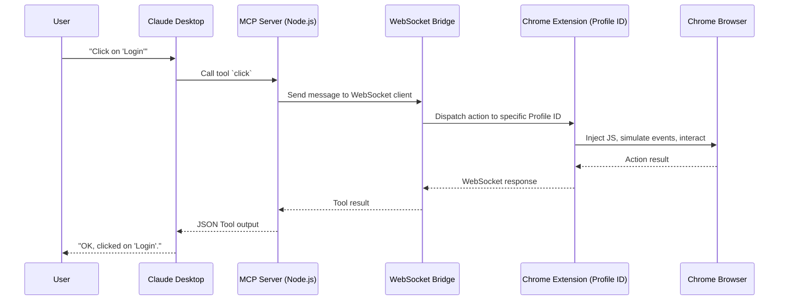

# Architecture Details 🏗️

IziTest Agent drives pages through a Chrome extension: in your own Chrome, where the application's logins and settings already are, or in a Chrome without windows for runs out of sight.

## The Connection Chain

## Technical Components

### 1. MCP Server (mcp-server/)
-   **SDK**: built using the `@modelcontextprotocol/sdk`.
-   **Dual Mode**: Can run as a `stdio` process (for Claude Desktop) or as an `SSE` (Server-Sent Events) server.
-   **Tool Registration**: Dynamically registers all tools (browser control, test recording).

### 2. WebSocket Bridge (lib/websocket.js)
-   **Port 3466**: The extension connects to the MCP server via standard WebSockets.
-   **Profiling**: Each WebSocket client (each extension instance) is tracked by a unique `Profile ID`.
-   **Async Commands**: Commands are sent with a unique ID to ensure that responses from the browser are correctly routed back to the right MCP tool call.

### 3. Chrome Extension (extension/)
-   **Manifest V3**: Uses modern Chrome extension APIs.
-   **Runtime Injection**: Instead of standard CDP scripts, it uses `chrome.scripting.executeScript` to inject minimal logic for element detection and event simulation.
-   **Element References (@eX)**: To minimize the amount of data sent to the AI (saving tokens), the extension generates short, stable UIDs for elements in the accessibility tree.

---

## Why a real Chrome

- **The application as its users see it**: your Chrome, its logins (SSO, two-factor), its
  settings. An agent recording a test does not have to script a login it can already use.
- **Out of sight when it should be**: tests and campaigns can also run in Chrome for Testing,
  without windows, with the same extension and a profile of its own. A test that needs a login
  then logs in itself.
- **Only its own windows**: in your Chrome, IziTest acts in the windows it opened, never in your
  tabs (see [parallel-sessions.md](parallel-sessions.md)).

---
[< Previous: Multi-Account Management](multi-account.md) | [Next: Configuration >](configuration.md)
