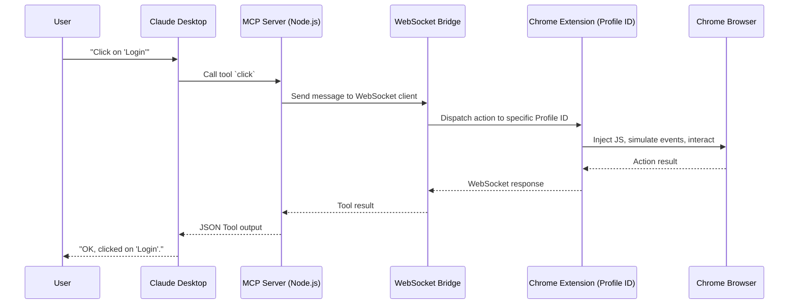

# Architecture Details 🏗️

IziTest Agent's architecture is built for stability and transparency. It avoids standard automation frameworks (Puppeteer, Selenium) to ensure 100% human-like behavior and fingerprinting.

## The Connection Chain

## Technical Components

### 1. MCP Server (mcp-server/)
-   **SDK**: built using the `@modelcontextprotocol/sdk`.
-   **Dual Mode**: Can run as a `stdio` process (for Claude Desktop) or as an `SSE` (Server-Sent Events) server.
-   **Tool Registration**: Dynamically registers all tools (browser control, test recording).

### 2. WebSocket Bridge (lib/websocket.js)
-   **Port 3456**: The extension connects to the MCP server via standard WebSockets.
-   **Profiling**: Each WebSocket client (each extension instance) is tracked by a unique `Profile ID`.
-   **Async Commands**: Commands are sent with a unique ID to ensure that responses from the browser are correctly routed back to the right MCP tool call.

### 3. Chrome Extension (extension/)
-   **Manifest V3**: Uses modern Chrome extension APIs.
-   **Runtime Injection**: Instead of standard CDP scripts, it uses `chrome.scripting.executeScript` to inject minimal logic for element detection and event simulation.
-   **Element References (@eX)**: To minimize the amount of data sent to the AI (saving tokens), the extension generates short, stable UIDs for elements in the accessibility tree.

---

## Why "Real Browser" Over "Headless"?

Traditional automation is easy to flag:
-   **Navigator Properties**: `navigator.webdriver` is `true` by default in automated browsers.
-   **TLS Fingerprinting**: Headless browsers often use different TLS/SSL stacks than real browsers.
-   **CSS Media Queries**: Headless browsers often fail `@media (prefers-reduced-motion)` or have weird screen dimensions.
-   **Extension Presence**: Some sites check for common extensions (AdBlock, etc.), which are usually missing in test environments.

**IziTest Agent inherits everything from your real browsing environment.** If you can browse a site as a human without being blocked, IziTest Agent can too.

---
[< Previous: Multi-Account Management](file:///Library/Dev/browser-pilot/docs/multi-account.md) | [Next: Configuration >](file:///Library/Dev/browser-pilot/docs/configuration.md)
