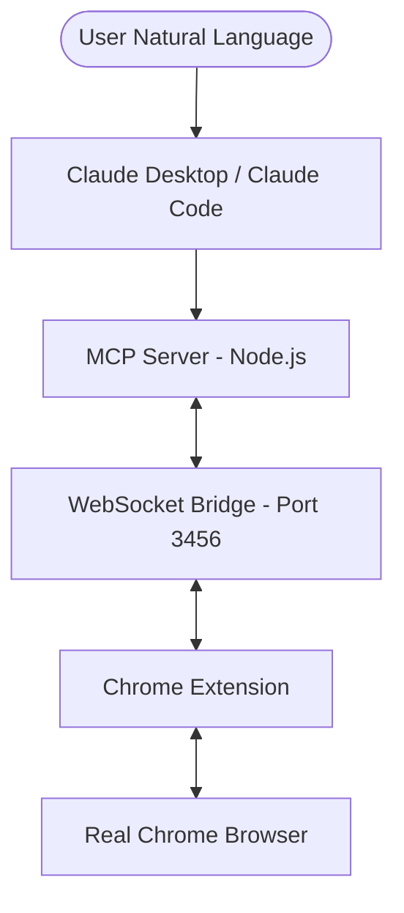

# Introduction to Browser Pilot 🎯

**Browser Pilot** is a minimalist but powerful framework designed to bridge the gap between AI agents (like Claude) and your real, daily-use web browser. Unlike traditional automation tools that use "headless" browsers or specialized drivers, Browser Pilot allows the AI to control your actual Chrome sessions, preserving your cookies, fingerprint, and logged-in states.

## Why Browser Pilot?

Traditional browser automation (Puppeteer, Selenium, Playwright) often suffers from two major problems:
1.  **Bot Detection**: Modern websites easily detect headless Chrome or CDP-injected browsers.
2.  **Context Loss**: Setting up sessions, cookies, and multi-factor authentication (MFA) in a script is a nightmare.

**Browser Pilot solves this by:**
- Using your **real browser** profile.
- Executing actions via an **official Chrome Extension**.
- Providing a **human-like** interaction layer.

## High-Level Architecture

Browser Pilot uses a multi-layered bridge to ensure stability and transparency:

## Key Technical Concepts

### 1. Real Browser, Real Fingerprint
Because it's your actual browser, you have your real user agent, plugins, fonts, and WebGL fingerprint. This makes Browser Pilot virtually indistinguishable from a human user.

### 2. Multi-Profile Isolation
The project is built to handle multiple Chrome profiles simultaneously. You can have a "Work" profile and a "Personal" profile connected at the same time, and Claude can target actions to specific profiles.

### 3. Snapshot-Based Interaction
Instead of making Claude guess where elements are, Browser Pilot provides a `snapshot` tool that scans the page and returns a compact, high-utility list of interactive elements with unique, short IDs (UIDs).

---
[Next: Installation >](file:///Library/Dev/browser-pilot/docs/installation.md)
