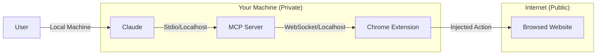

# Security Considerations 🔒

IziTest Agent is designed to run locally and give you full control over your browser data. However, since it allows an AI to control your real browser, several safety measures are in place.

## Data Privacy & Protection

### 1. Localhost Only
The WebSocket bridge and MCP server listen **exclusively** on `127.0.0.1` (localhost). No ports are exposed to the public internet by default. This ensures that only your local AI (Claude Desktop/Code) can communicate with your browser instances.

### 2. Websites You Visit Cannot Drive It
Localhost is not a wall against the browser IziTest Agent pilots: any page open in that Chrome can send requests to `127.0.0.1`. Left unchecked, a site you merely visit could open an MCP session and call `execute_js` or `get_cookies` with your real sessions. So:

- **WebSocket bridge (port 3466), always**: only a Chrome extension may connect (`Origin: chrome-extension://…`). A web page is refused, whatever its origin. Clients that are not browsers (tests, tools) send no `Origin` and pass.
- **HTTP server (port 3467), without `IZITEST_TOKEN`**: a browser request is refused unless it comes from a local page (`http://localhost:*`, `http://127.0.0.1:*`: the dashboard and its Vite dev server) or from an origin listed in `IZITEST_ALLOWED_ORIGINS`. `Origin: null` (sandboxed iframes, `file://`) is refused. The `Host` header must be local too, which stops DNS rebinding. CORS echoes the accepted origin, never `*`. Local MCP clients, `curl` and scripts send no `Origin` and are not affected.
- **HTTP server with `IZITEST_TOKEN`**: every route except `/health` requires the token, so a page without it gets nothing. Required as soon as `MCP_HOST` is not loopback.

A refused request answers `403` and leaves a line in `mcp-server/data/server.log`.

### 3. Cookie Masking
When using the `get_cookies` tool, IziTest Agent **masks** sensitive cookie values. It only returns the first 50 characters of a cookie's value to the AI, preventing full session tokens from being sent to external LLM providers (Anthropic, OpenAI, etc.) while still allowing the AI to verify if a cookie exists.

### 4. Execution Context
JavaScript executed via the `execute_js` tool runs within the **Chrome extension's sandbox** or the **page context**. It does not have access to your local file system, environmental variables, or other sensitive system data outside the browser.

---

## Best Practices for Users

### 1. Dedicated Profiles
We strongly recommend using **separate Chrome profiles** for sensitive work (e.g., banking) and IziTest Agent automation. See our [Multi-Account Guide](multi-account.md) for more details.

### 2. Monitor AI Actions
Always keep an eye on the browser window while an AI is performing tasks. Claude is generally very reliable, but browser automation can sometimes encounter unexpected edge cases on dynamic websites.

### 3. Review Permissions
The Chrome extension requires permissions to access `tabs`, `scripting`, and `activeTab`. These are the minimum required to interact with your pages as a human would.

---

## Technical Security Layout

---

## Data Storage

IziTest Agent stores data locally in the following locations:

### Database
- **Location** : `mcp-server/data/izitest.db` (SQLite)
- **Content** : Tests enregistrés, variables, étapes, assertions
- **Protection** : Les fichiers ne sont accessibles que par l'utilisateur courant

### Secrets of a project
- **Location** : the `secrets` table of the database, each value encrypted (AES-256-GCM); the key is
  `IZITEST_SECRET_KEY`, or `~/.izitest/secret.key` (0600), never in the database
- **Read by** : the server only, to type it — recording and replaying. The API lists names, never a
  value; what any tool answers an agent, the logs and a run's record carry `{{secret.NAME}}` in its
  place; snapshots mask password fields
- **Not covered** : a screenshot, or a run's video, of a page that shows a secret in plain text (a
  password field shows dots). Keep secrets for test accounts. See
  [mcp-tools.md](mcp-tools.md#secrets--ce-quun-test-tape-sans-que-personne-le-lise)

### Screenshots
- **Location** : `mcp-server/data/baselines/` et `mcp-server/data/assertion-screenshots/`
- **Content** : Captures d'écran pour VRT (Visual Regression Testing)
- **Lifecycle** : Les screenshots d'assertion échouées sont conservés pour diagnostic

### Chrome Profiles
- **Location** : `~/.izitest/profiles/<profile-name>/`
- **Content** : Données Chrome isolées (cookies, historique, localStorage)
- **Note** : Ces données sont gérées par Chrome lui-même

---
[< Previous: Configuration](configuration.md) | [Next: Troubleshooting >](troubleshooting.md)
