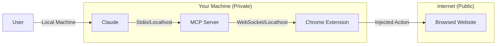

# Security Considerations 🔒

IziTest Agent is designed to run locally and give you full control over your browser data. However, since it allows an AI to control your real browser, several safety measures are in place.

## Data Privacy & Protection

### 1. Localhost Only
The WebSocket bridge and MCP server listen **exclusively** on `127.0.0.1` (localhost). No ports are exposed to the public internet by default. This ensures that only your local AI (Claude Desktop/Code) can communicate with your browser instances.

### 2. Cookie Masking
When using the `get_cookies` tool, IziTest Agent **masks** sensitive cookie values. It only returns the first 50 characters of a cookie's value to the AI, preventing full session tokens from being sent to external LLM providers (Anthropic, OpenAI, etc.) while still allowing the AI to verify if a cookie exists.

### 3. Execution Context
JavaScript executed via the `execute_js` tool runs within the **Chrome extension's sandbox** or the **page context**. It does not have access to your local file system, environmental variables, or other sensitive system data outside the browser.

---

## Best Practices for Users

### 1. Dedicated Profiles
We strongly recommend using **separate Chrome profiles** for sensitive work (e.g., banking) and IziTest Agent automation. See our [Multi-Account Guide](file:///Library/Dev/browser-pilot/docs/multi-account.md) for more details.

### 2. Monitor AI Actions
Always keep an eye on the browser window while an AI is performing tasks. Claude is generally very reliable, but browser automation can sometimes encounter unexpected edge cases on dynamic websites.

### 3. Review Permissions
The Chrome extension requires permissions to access `tabs`, `scripting`, and `activeTab`. These are the minimum required to interact with your pages as a human would.

---

## Technical Security Layout

---

## Data Storage

IziTest Agent stores data locally in the following locations:

### Database
- **Location** : `mcp-server/data/tests.db` (SQLite)
- **Content** : Tests enregistrés, variables, étapes, assertions
- **Protection** : Les fichiers ne sont accessibles que par l'utilisateur courant

### Screenshots
- **Location** : `mcp-server/data/baselines/` et `mcp-server/data/assertion-screenshots/`
- **Content** : Captures d'écran pour VRT (Visual Regression Testing)
- **Lifecycle** : Les screenshots d'assertion échouées sont conservés pour diagnostic

### Chrome Profiles
- **Location** : `~/.browser-pilot/profiles/<profile-name>/`
- **Content** : Données Chrome isolées (cookies, historique, localStorage)
- **Note** : Ces données sont gérées par Chrome lui-même

---
[< Previous: Configuration](file:///Library/Dev/browser-pilot/docs/configuration.md) | [Next: Troubleshooting >](file:///Library/Dev/browser-pilot/docs/troubleshooting.md)
